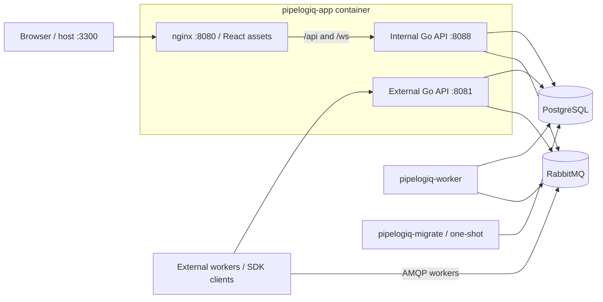

# Architecture

## Overview

Pipelogiq has two planes:

- **Control plane** — the app server and built-in worker that manage pipeline state, stage execution ordering, and real-time updates
- **Data plane** — external workers (connected via SDK or raw HTTP) that receive stage jobs, execute domain logic, and report results

The backend source is in `apps/go` and uses Go 1.26.8. The dashboard is in
`apps/web`, built with Node.js 24 LTS. The .NET samples in `examples/dotnet`
target .NET 8 and use the sibling SDK checkout.

## Components

### pipelogiq-app

A single container bundles the React dashboard, nginx and the Go API binary.
nginx listens on container port **8080**, published as host port **3300** by
Compose. It serves the static dashboard, strips `/api` when proxying HTTP
requests, and forwards `/ws` to the internal Go API at `localhost:8088`.

| Listener | Combined container | Direct local Go/Vite |
| --- | --- | --- |
| Dashboard | nginx `8080`, host `3300` | Vite `3300` |
| Internal API | Go `8088`, reached through nginx `/api` | Go `8080` by default |
| External SDK API | `8081`, host `8081` | `8081` |
| API metrics | Separate listener `9091` | `9091` by default |
| Worker metrics | `9090` when configured | Set `METRICS_ADDR` on the worker |

The registry Compose configuration publishes only dashboard and external API
ports. Development Compose also publishes worker metrics and infrastructure
ports; production access to these listeners must be configured deliberately.

The API server exposes two HTTP servers on separate ports:

**Internal API (`:8088` in the app container)** — supplies dashboard data and
operations. Authentication uses an HS256 JWT in an HttpOnly cookie. Each request
checks the active account, current role, session version and application access.
The Admin, Operator and Viewer roles are enforced on the server; even Admin data
access respects assigned applications. Endpoints include:

- Auth (login, logout, current user)
- Pipelines (inspection, stages, context, logs, pause/resume, rerun/skip and bulk actions)
- Schedules and recorded schedule runs
- Users, roles, application memberships and user activity audit
- Applications and API keys
- Workers and worker events
- Observability config, traces, insights
- Action policies
- WebSocket (`/ws`) for real-time pipeline updates
- Health (`/healthz`, `/readyz`) and version (`/version`)

Metrics are served at `/metrics` on the separate metrics listener, never through
nginx `/api/metrics`. WebSocket connections enforce the same application scope
and close on session expiry or revocation. Settings groups user management,
audit, API keys, licensing and account settings; see
[Users and access](user-management.md) and [User activity audit](audit.md).

**External API (`:8081`)** — serves SDK clients and external workers. Application
authentication uses `X-API-Key`; worker-protocol operations after bootstrap also
require the worker session. Endpoints include:

- `POST /pipelines` — create a pipeline
- `POST /pipelines/idempotent` and `POST /pipelines/by-idempotency-key` — create or find an idempotent pipeline
- `GET /pipelines/{pipelineId}` and `POST /pipelines/{pipelineId}/cancel` — inspect or cancel an application-owned pipeline
- `POST /pipelines/{pipelineId}/stages` — append stages to an existing pipeline
- `POST /stages/{stageId}/resume` — resume an approval-waiting stage
- `POST /stages/{stageId}/lease/acquire`, `/lease/renew` and `/result` — lease and report an execution
- `POST /jobs/pull` — pull the next stage job for a handler
- `POST /jobs/ack` — acknowledge or reject a stage job
- `POST /logs` — submit application logs
- `POST /workers/bootstrap` — register a worker and receive a session token
- `POST /workers/heartbeat` — report worker health and metrics
- `POST /workers/events` — submit worker events
- `POST /workers/shutdown` — graceful shutdown notification

The route contract is [OpenAPI](openapi.external.yaml). For transport and
execution guarantees, see [HTTP workers](http-workers.md) and
[Reliable execution](reliable-execution.md).

### pipelogiq-worker

The built-in worker runs alongside the app and handles:

- **Publisher** — polls the database for stages ready to execute, evaluates rate-limit and block policies before dispatching, and publishes approved stages to RabbitMQ queues
- **Result consumer** — processes stage results from workers, evaluates retry policies (including `retryOn` error code filtering and exponential/linear/fixed backoff), updates pipeline state, and triggers the next stage
- **Status consumer** — handles out-of-band stage status updates
- **Active-stage timeout watcher** — marks `Pending` or `Running` stages that exceed their configured or policy-effective timeout as `Failed`
- **Schedule runner and recovery** — creates due pipeline runs and recovers eligible interrupted dispatches and expired execution leases
- **Prometheus metrics** — exposes counters on its configured listener (`:9090` in Compose)

### External workers

External workers connect to the external API (`:8081`) to:

1. **Bootstrap** — register with the control plane, receive a session token and queue topology
2. **Receive jobs** — consume AMQP deliveries or use the HTTP long-poll transport
3. **Execute** — acquire and renew an execution lease, then run the stage handler
4. **Report and acknowledge** — submit the execution result and acknowledge the delivery; execution ID and attempt fence stale results
5. **Heartbeat** — periodically report health metrics (CPU, memory, queue lag, in-flight count)
6. **Shutdown** — notify the control plane before stopping

### Database

PostgreSQL is the deployment datastore; the supplied development stack uses
PostgreSQL 16. Liquibase manages the schema in `database/changelog.xml`. A
separate `pipelogiq-migrate` container applies it before the app starts; the app
entrypoint does not run migrations and no longer honors `LIQUIBASE_ENABLED`.
The Helm chart uses a migration Job for install and upgrade.

`DATABASE_URL` is required by default. Setting `ALLOW_SQLITE_FALLBACK=true`
explicitly opts into a local SQLite file for experiments. SQLite does not replace
PostgreSQL integration and upgrade testing. Secrets marked sensitive remain
redacted from dashboard payloads, logs, live updates and audit exports.

### Message broker

RabbitMQ handles stage job dispatch and result collection. Key exchanges and queues:

- Per-handler queues: `app_{applicationId}_{handler}_StageNext` — stable numeric application scope and handler routing, returned by worker bootstrap
- `StageResult` — worker results
- `StageUpdated.fanout` — broadcasts stage updates to WebSocket clients
- Dead-letter retry queues — controlled by `RABBIT_DLQ_ENABLED` (enabled by default) and `RABBIT_DLQ_TTL`

### React dashboard

Single-page app built with React 19, TypeScript, Vite, TanStack Query, Tailwind CSS, and Radix UI. Communicates with the internal API and receives real-time updates via WebSocket.

The pipeline list is the primary operations surface. It supports bulk pause/resume for selected pipelines and failed-stage rerun/skip actions scoped to the selected pipelines. Pipeline detail keeps stage controls individual, so inspection stays focused on one stage at a time.

Retry and throttle states are shown explicitly in the dashboard. Internally, retry backoff uses `RetryScheduled`, which the UI presents as `Rescheduled`; throttled stages remain visible as `Throttled`. Both states show the next scheduled run time when available. Stages that failed and later recovered keep an icon-only failure-history marker.

## Stage Execution Flow

1. A pipeline is created via `POST /pipelines` (external API)
2. The publisher finds the first ready stage and evaluates active policies:
   - **Rate-limit** policy → stage is throttled (status `Throttled`) and retried after the throttle window
   - **Block** policy → stage is immediately failed
   - No matching policy → stage is marked `Pending` and published to the handler's RabbitMQ queue
3. An external worker receives the job, acquires an execution lease, executes the handler, and reports its result (including an optional `errorCode`) before acknowledging the delivery
4. The result consumer receives the result and evaluates **retry** policies:
   - If a retry policy matches (and `retryOn.errorCodes` includes the reported `errorCode`, if set), the stage is rescheduled with computed backoff delay and status `RetryScheduled`
   - If no retry policy matches, the stage falls back to its per-stage `maxRetries`/`retryInterval` options
   - If neither applies, the stage is marked `Completed` or `Failed`
5. If completed, the publisher picks the next stage
6. Pipeline status follows the terminal stage outcomes: success and failure are
   distinct, while explicit cancellation follows its own path

Delivery is at least once; execution leases and result fencing reduce duplicate
processing but do not provide exactly-once external side effects. Handlers must
make side effects idempotent or reconcile uncertain outcomes.

## Policy Runtime

Policies are stored in PostgreSQL and loaded by the runtime at dispatch and result-processing time. Both the API and worker read policies from the `policy` table directly, so policies are available in distributed deployments without any shared filesystem.

Policy trigger events are written to the `policy_event` table and are visible in the dashboard under **Policies → Audit**.

### Policy types

| Type | Where evaluated | Effect |
|------|----------------|--------|
| `rate_limit` | Publisher (before dispatch) | Throttles or blocks stage dispatch |
| `retry` | Result consumer (on failure) | Schedules retry with backoff |
| `timeout` | Active-stage watcher | Enforces per-stage execution deadline |
| `circuit_breaker` | Publisher (before dispatch) | Blocks dispatch when error threshold is exceeded |

### Retry backoff

The `retry` policy rule supports three backoff strategies:

- `fixed` — constant delay equal to `baseDelayMs`
- `linear` — delay grows as `baseDelayMs × attempt`
- `exponential` — delay doubles each attempt starting from `baseDelayMs`

All strategies respect `maxDelayMs` as a ceiling. Set `jitter: true` to add ±10% randomness and avoid thundering-herd patterns.

Use `retryOn.errorCodes` to retry only on specific failure kinds (e.g. `RATE_LIMIT_EXCEEDED`). Stages that fail with an unmatched code are marked `Failed` immediately.

## Deployment

`infra/compose/docker-compose.build.yml` builds the full stack from source.
`docker-compose.registry.yml` runs pinned release images. Component Compose
files separate infrastructure, app plus migration, and worker; start healthy
infrastructure before the app, and the app before the worker. Schema migrations
must finish before updated application processes run.

The API and orchestration worker can be deployed independently with PostgreSQL
and RabbitMQ access. Helm deployment assets are in `infra/helm/pipelogiq`.

Build metadata (version, commit and date) is injected through Go linker flags
and image labels. `make build` writes `bin/api` and `bin/worker` at the repository
root. Check a combined container through
`curl http://localhost:3300/api/version`; for a directly running default Go API,
use `curl http://localhost:8080/version`. See [CONTRIBUTING.md](../CONTRIBUTING.md)
for local commands and [RELEASE.md](../RELEASE.md) for release gates and artifacts.
