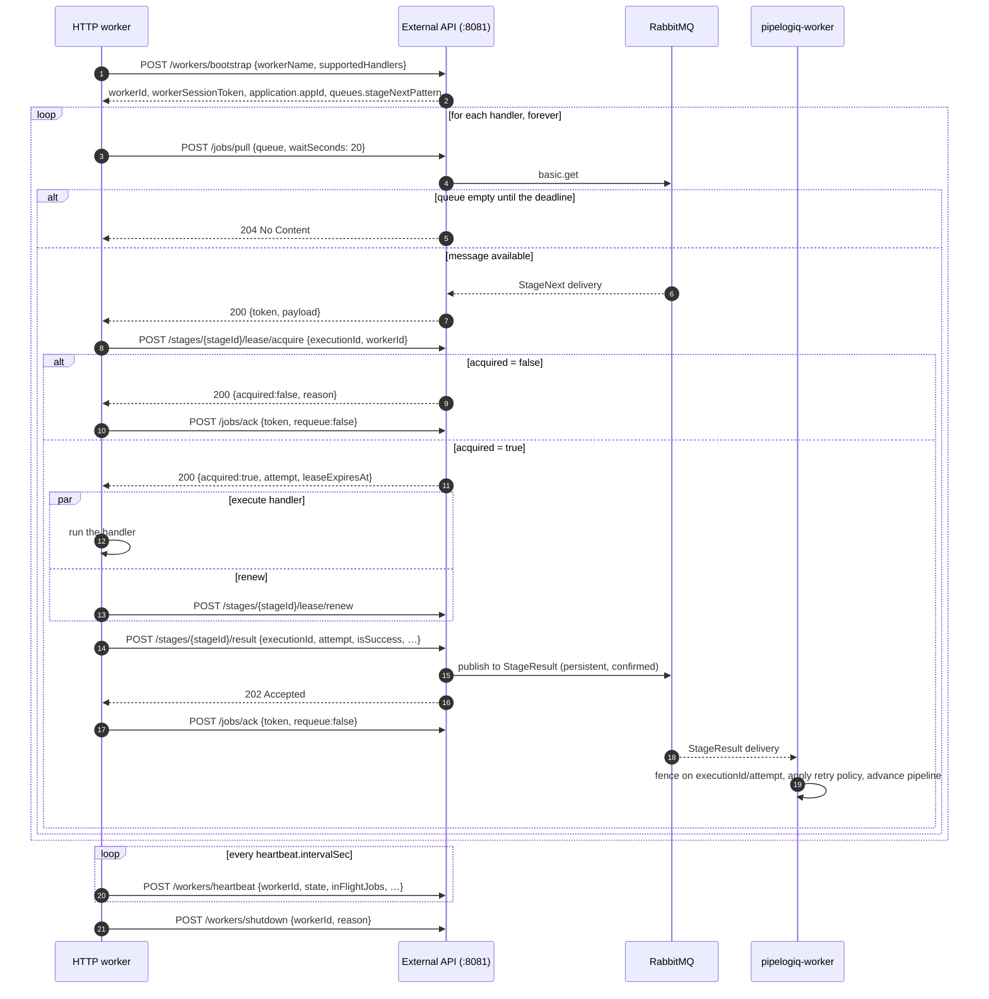

# HTTP worker protocol

A Pipelogiq worker normally consumes stage jobs over AMQP. This document
describes the alternative: a worker that speaks only HTTP to the external API on
`:8081` and never opens a broker connection. It is the exact contract, so an
implementation can be written from this page without reading Go.

Everything below is additive. AMQP workers are unaffected, and the two kinds of
worker can serve the same application at the same time.

## When to use it

Use HTTP workers when the process cannot take a `RabbitMQ.Client` (or equivalent)
dependency — a policy rule, a constrained runtime, a serverless host — or when
the worker sits behind a network boundary that only allows outbound HTTPS.

Prefer AMQP otherwise. Pull is a poll: an HTTP worker with a 20-second long poll
sees a new job within a few hundred milliseconds, while an AMQP consumer is
pushed the delivery immediately.

## What you need

- The external API base URL (`http://localhost:8081` in the Compose stack).
- An application API key, sent as `X-API-Key` on every request.
- The worker session token from bootstrap, sent as `X-Worker-Session` on every
  worker-protocol request.

Both are secrets. Do not log them, and do not log stage result payloads.

## Sequence



## 1. Bootstrap

```http
POST /workers/bootstrap
X-API-Key: <application API key>
Content-Type: application/json

{
  "workerName": "tiqet-orders",
  "instanceId": "orders-7c9f",
  "workerVersion": "1.4.0",
  "environment": "production",
  "hostName": "vps-1",
  "supportedHandlers": ["ReserveSeatsHandler", "CapturePaymentHandler"]
}
```

`workerName` is required; everything else is optional. Response:

```json
{
  "workerId": "…",
  "workerSessionToken": "…",
  "configVersion": "2026-09-06T10:00:00Z",
  "application": {
    "applicationId": 12,
    "applicationName": "tiqet",
    "appId": "app_12"
  },
  "messageBroker": { "type": "rabbitmq", "connectionString": "…", "prefetch": 10 },
  "queues": {
    "stageResult": "StageResult",
    "stageSetStatus": "StageSetStatus",
    "stageUpdatedFanout": "StageUpdated.fanout",
    "stageNextPattern": "{appId}_{handler}_StageNext"
  },
  "heartbeat": { "intervalSec": 15, "offlineAfterSec": 45 }
}
```

An HTTP worker uses `workerId`, `workerSessionToken`, `application.appId`,
`queues.stageNextPattern`, and `heartbeat.intervalSec`. Ignore
`messageBroker.connectionString`; it exists for AMQP workers and must never be
logged.

The session token expires after `WORKER_SESSION_TTL` (default 24 h). Bootstrap
again when any worker-protocol call answers `401`.

## 2. Queue names

`queues.stageNextPattern` is returned literally as:

```
{appId}_{handler}_StageNext
```

Substitute `application.appId` for `{appId}` and the handler name for
`{handler}`. `appId` is `app_{applicationId}`, so for application 12 and handler
`CapturePaymentHandler` the queue is:

```
app_12_CapturePaymentHandler_StageNext
```

The handler name is the `stageHandlerName` used when the pipeline stage was
created. Pull one queue per handler in `supportedHandlers`.

`POST /jobs/pull` accepts only queues of the authenticated application, and only
ones matching that pattern with a non-empty handler segment that has no path
separator, whitespace, or control character. Anything else is `403`.

## 3. Pull a job

```http
POST /jobs/pull
X-API-Key: <application API key>
X-Worker-Session: <worker session token>
Content-Type: application/json

{ "queue": "app_12_CapturePaymentHandler_StageNext", "waitSeconds": 20 }
```

`waitSeconds` is `0..20` and defaults to `0`. With `0` the server answers `204`
immediately when the queue is empty. With a positive value it waits up to that
many seconds for a message before answering `204`. Use `20` — it keeps the
request under the server's 60-second router timeout and avoids hot-polling.

`204` is the normal empty answer: loop straight back into the next pull.

`200` returns one delivery:

```json
{
  "token": "6f9b…",
  "queue": "app_12_CapturePaymentHandler_StageNext",
  "messageId": "…",
  "payload": {
    "appId": 12,
    "pipelineId": 273,
    "stageId": 81,
    "executionId": "…",
    "attempt": 2,
    "idempotencyKey": "order-8891",
    "timeoutSeconds": 120,
    "stageHandlerName": "CapturePaymentHandler",
    "input": "{\"orderId\":8891}",
    "prevStageOutput": "{\"seats\":3}",
    "contextItems": [ { "key": "customerId", "value": "\"c-31\"", "valueType": "System.String" } ],
    "traceId": "…",
    "spanId": "…",
    "traceparent": "00-…-…-01"
  }
}
```

`payload` is the `StageNext` message. `token` is the in-flight handle for
`/jobs/ack`; it is not the message and it is not a lease.

Until the token is acked the message stays unacknowledged on the broker. If it
is not acked within `GATEWAY_VISIBILITY_TIMEOUT` (default 60 s) the server
requeues the message and another pull will receive it.

`429` means the gateway is holding `GATEWAY_MAX_INFLIGHT` unacked messages. Back
off 1 second and pull again.

## 4. Acquire the lease

Never execute a handler on the strength of a delivery alone. A redelivery, a
recovered stage, and a second worker all produce the same `stageId`; the lease is
what decides who runs it.

```http
POST /stages/81/lease/acquire
X-API-Key: <application API key>
X-Worker-Session: <worker session token>
Content-Type: application/json

{ "executionId": "…", "workerId": "…" }
```

Pass the `executionId` from the delivery and the `workerId` from bootstrap.

```json
{ "acquired": true, "attempt": 2, "leaseExpiresAt": "2026-09-06T10:01:00Z" }
```

`acquired: false` is a successful response, not an error. Do not execute; ack the
job with `requeue: false` and continue with the next pull. The `reason` says why:

| `reason` | Meaning |
|---|---|
| `stale_execution` | The delivery carries an execution token the server has superseded. |
| `lease_held` | Another worker owns an unexpired lease for this execution. |
| `lease_expired` | The stage is `Running` with no valid lease; recovery will re-dispatch it. |
| `stage_not_active` | The stage is no longer `Pending` or `Running`. |
| `pipeline_terminal` | The pipeline is `Completed`, `Failed`, or `Cancelled`. |
| `application_mismatch` | The stage belongs to another application. |
| `lease_not_acquired` | A concurrent acquisition won the race. |

## 5. Renew while the handler runs

The default lease is `DefaultStageLeaseDuration` = 60 seconds. Renew every
`(leaseExpiresAt − now) / 2` — about every 30 seconds — while the handler runs:

```http
POST /stages/81/lease/renew
X-API-Key: <application API key>
X-Worker-Session: <worker session token>
Content-Type: application/json

{ "executionId": "…", "workerId": "…" }
```

Renewal returns `acquired: false` with `lease_not_owned` when the lease was taken
over or the execution was superseded, and `pipeline_terminal` after a
cancellation. Both mean the same thing: stop the handler cooperatively — cancel
the token you passed into every HTTP, database, and queue call — and do not post
a result. The server has already moved on and would fence the result anyway.

Cancellation is cooperative. A handler that ignores its cancellation token keeps
running after the pipeline is terminal.

## 6. Execute and report the result

```http
POST /stages/81/result
X-API-Key: <application API key>
X-Worker-Session: <worker session token>
Content-Type: application/json

{
  "pipelineId": 273,
  "stageId": 81,
  "executionId": "…",
  "attempt": 2,
  "isSuccess": false,
  "result": "Stripe reports the checkout is still open.",
  "errorCode": "PAYMENT_PENDING",
  "retryable": true,
  "logs": [ { "message": "polled Stripe", "logLevel": "Info" } ],
  "contextItems": [ { "key": "paymentOutcome", "value": "\"Pending\"", "valueType": "System.String" } ],
  "appendedStages": []
}
```

Echo `executionId` and `attempt` from the delivery unchanged — they are what the
consumer fences on. `stageId` must equal the one in the route.

`202` means the result was confirmed onto the `StageResult` queue, not that it
was applied. The result consumer in `pipelogiq-worker` decides the outcome:
fencing, retry-policy evaluation, and pipeline advancement all happen there, the
same as for AMQP workers. A stale or duplicate result is also `202`.

Set `errorCode` for a failure so retry policies and `retryOnErrorCodes` can
classify it. `retryable` overrides that classification when you know better.
`result` is capped at 262144 bytes, the same limit as stage input.

See [Reliable execution](reliable-execution.md) for the retry and terminal-result
semantics behind these fields.

## 7. Acknowledge the job

```http
POST /jobs/ack
X-API-Key: <application API key>
Content-Type: application/json

{ "token": "6f9b…", "requeue": false }
```

The rule is one sentence: **ack with `requeue:false` only after
`POST /stages/{stageId}/result` returned `202`.**

Requeue (`requeue: true`) when the handler has not started and will not start:

- the lease was not acquired for a reason that warrants another delivery;
- the process is shutting down before execution started.

Do not requeue after the handler ran and the result was accepted — that executes
the work twice. If the handler ran but the result could not be posted, keep
retrying the result until the lease expires, then requeue; the new execution gets
a fresh token and the old result would be fenced anyway.

`404` means the token expired and the sweeper already requeued the message.
Nothing to do: a redelivery is on its way.

## 8. Heartbeat and shutdown

Every `heartbeat.intervalSec` seconds:

```http
POST /workers/heartbeat
X-API-Key: <application API key>
X-Worker-Session: <worker session token>
Content-Type: application/json

{
  "workerId": "…",
  "state": "Running",
  "inFlightJobs": 1,
  "jobsProcessed": 412,
  "jobsFailed": 3,
  "uptimeSec": 8400
}
```

A worker that misses heartbeats for `heartbeat.offlineAfterSec` is shown offline
in the dashboard. On stop:

```http
POST /workers/shutdown
X-API-Key: <application API key>
X-Worker-Session: <worker session token>
Content-Type: application/json

{ "workerId": "…", "reason": "sigterm" }
```

## Failure matrix

| Where | Status | What to do |
|---|---|---|
| any worker-protocol call | `401` | The session token is missing, expired, or invalid. Bootstrap again and retry once. |
| `/jobs/pull` | `403` | The queue is not this application's. A configuration bug — fix the handler name; do not retry in a loop. |
| `/jobs/pull` | `429` | Too many in-flight messages. Back off 1 second, then pull again. |
| `/jobs/pull` | `5xx` | Back off exponentially from 1 s to 30 s and keep pulling. |
| `/stages/{id}/lease/acquire` | `acquired:false` | Do not execute. Ack with `requeue:false` and continue. |
| `/stages/{id}/lease/renew` | `acquired:false` | Stop the handler cooperatively. Do not post a result. |
| `/stages/{id}/result` | `503` | The broker did not confirm. Retry with backoff until the lease expires, then requeue the job. Retrying is safe; the consumer fences duplicates. |
| `/stages/{id}/result` | `400` | A bug in the worker. Log the problem+json body, ack without requeue, and fail loudly — retrying will not help. |
| `/stages/{id}/result` | `403`/`404` | The stage is gone or not yours. Ack without requeue. |
| `/jobs/ack` | `404` | The token expired; the message was already requeued. Continue. |

Every `4xx` and `5xx` on the result and resume endpoints carries an
`application/problem+json` body with `type`, `title`, `detail`, `traceId`, and
per-field `errors`. Log `traceId`; it is the request ID in the server logs.

## Walkthrough with curl

Start the stack:

```bash
make compose-up
```

Set the base URL and the API key created by the bootstrap environment (see
[Quick Start](quickstart.md)):

```bash
export PL=http://localhost:8081
export KEY=<your application api key>
```

Bootstrap a worker and keep the session token:

```bash
curl -sS -X POST "$PL/workers/bootstrap" -H "X-API-Key: $KEY" -H 'Content-Type: application/json' -d '{"workerName":"curl-worker","supportedHandlers":["DemoHandler"]}'
```

Export the values it returned:

```bash
export SESSION=<workerSessionToken>
export WORKER=<workerId>
export APPID=<application.appId>
```

Create a one-stage pipeline for that handler:

```bash
curl -sS -X POST "$PL/pipelines/idempotent" -H "X-API-Key: $KEY" -H 'Content-Type: application/json' -d '{"idempotencyKey":"curl-demo-1","name":"curl-demo","stages":[{"stageName":"demo","stageHandlerName":"DemoHandler","input":"{}"}]}'
```

Long-poll for the job:

```bash
curl -sS -X POST "$PL/jobs/pull" -H "X-API-Key: $KEY" -H "X-Worker-Session: $SESSION" -H 'Content-Type: application/json' -d "{\"queue\":\"${APPID}_DemoHandler_StageNext\",\"waitSeconds\":20}"
```

Take `token`, and `stageId`/`executionId` from `payload`:

```bash
export TOKEN=<token>
export STAGE=<payload.stageId>
export EXEC=<payload.executionId>
```

Acquire the lease:

```bash
curl -sS -X POST "$PL/stages/$STAGE/lease/acquire" -H "X-API-Key: $KEY" -H "X-Worker-Session: $SESSION" -H 'Content-Type: application/json' -d "{\"executionId\":\"$EXEC\",\"workerId\":\"$WORKER\"}"
```

Post the result, then ack:

```bash
curl -sS -X POST "$PL/stages/$STAGE/result" -H "X-API-Key: $KEY" -H "X-Worker-Session: $SESSION" -H 'Content-Type: application/json' -d "{\"pipelineId\":null,\"stageId\":$STAGE,\"executionId\":\"$EXEC\",\"attempt\":1,\"isSuccess\":true,\"result\":\"{\\\"ok\\\":true}\"}"
```

```bash
curl -sS -X POST "$PL/jobs/ack" -H "X-API-Key: $KEY" -H 'Content-Type: application/json' -d "{\"token\":\"$TOKEN\",\"requeue\":false}"
```

Confirm the pipeline completed:

```bash
curl -sS "$PL/pipelines/<pipelineId>" -H "X-API-Key: $KEY"
```

`scripts/http-worker-smoke.sh` runs this whole loop, including a retryable
failure followed by a success, and asserts the outcome.

## Implementation checklist

- One pull loop per handler, `waitSeconds: 20`.
- Never execute without `acquired: true`.
- Renew at half the remaining lease; stop the handler when renewal is refused.
- Post the result before acking; ack with `requeue:false` only after `202`.
- Re-bootstrap on `401` and retry the call once.
- Bound handler execution by `payload.timeoutSeconds`.
- Propagate `payload.traceparent` into outgoing calls.
- Never log the API key, the session token, or result payloads.
